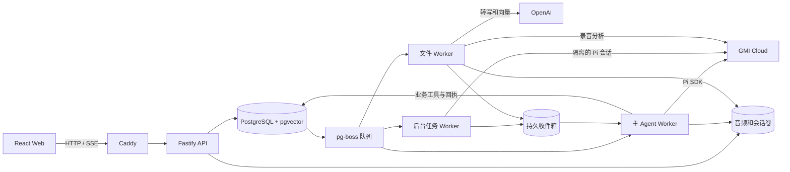

# 架构与数据流

Nota 在一个部署中运行 Web/API 和三类 Worker。PostgreSQL 保存用户、业务对象、作业、执行回执和用户事件。文件卷保存原始音频和 Pi SDK 会话，数据库记录所属账号、文件标识与索引。

## 对话与执行

- 每个账号有一个持久的 Pi 主会话，主 Agent 按账号串行执行。SDK 达到上下文阈值后压缩活动会话，产品消息和原始会话历史仍可查。压缩退出活动上下文的用户消息会进入增量[记忆扫描](MEMORY.md#三个生成入口)。
- API 将输入、操作和额度预占持久化，Worker 通过 pg-boss 接受唤醒。操作状态和租约决定能否恢复或提交结果。工具调用使用服务端绑定的账号，写入与业务回执在事务内提交。
- 主会话支持[运行中引导](STEERING.md)。执行版本用于处理并行到达的更正，已提交的业务结果可通过更新工具修订。
- 前端通过 SSE 接收执行与消息事件，按持久游标恢复同步。账号级阅读进度独立记录，见[对话与已读进度](CONVERSATION.md)。

## 录音与后台任务

- 文件 Worker 转写音频、存储转写版本、生成出处索引并进行结构化分析。每个窗口最多容纳十条录音，成员到达终态后统一交接给主 Agent。一条录音的转写、摘要和后续工具共享同一份额度预占。详见[录音处理](RECORDING_PIPELINE.md)。
- Task Worker 使用独立 Pi 会话处理定时或外部触发的查询。后台结果先持久化，再由主 Agent 在对话中汇报。查询与交付共享一次额度，见[后台任务](BACKGROUND_TASKS.md)和[任务列表](TASKS.md)。
- 日期和时间由[日程业务对象](AGENDA.md)管理。到时提醒由调度器直接投递；提醒和后台结果进入[通知](NOTIFICATIONS.md)。

## 检索与存储

- 历史检索按用户及当前来源版本过滤，组合关键词和 pgvector 结果。原文引用能定位到指定录音版本或聊天文段。向量服务不可用时仍可按关键词查询。
- 长期记忆与来源证据可以分别查询。事实更新保留历史，已有业务对象通过 ID 关联。查看音频、聊天、工具回执和事件流都需要账号授权。
- `src/server/` 包含 API、Agent、队列、数据模型与迁移。Web 应用在 `src/web/`，双方共用的类型与规则在 `src/shared/`。测试及合成输入在 `tests/`。

## 额度与订阅

Free 默认每日允许 10 次新的 AI 处理，按 Asia/Shanghai 业务日重置。澄清、引导和内部重试沿用原交办。操作预占通过事务控制，成功结算，终态失败释放。手动管理事项和提醒投递不消耗 AI 额度。Pro 权益由服务端订阅状态和有效期决定，默认在演示模式运行。
