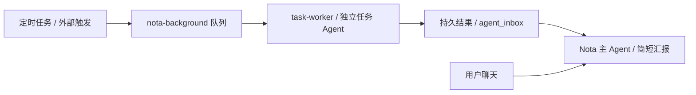

# 定时查询与后台 Agent

定时查询和外部触发先进入独立后台 Agent，完成后将结果交给用户的 Nota 主 Agent 汇报。录音处理通过文件流水线执行，到点提醒由调度器直接投递。

## 执行与会话

- `worker` 消费 `nota-user`，每个用户保留一个持续会话，聊天优先于待交付的后台结果。
- `task-worker` 消费 `nota-background`，每次触发对应独立 operation、任务级锁、租约及 SDK 会话。默认并发 2，最多 16 个模型回合，沿用单次执行时间上限。
- 后台会话保存于 `task-sessions/<user>/<operation>/`。不打开或更新 `bot_state` 指向的主会话，不取得用户级会话锁，不接入前台聊天引导。
- 创建任务时，prompt 应包含查询目标、已确认的日期和相关偏好。后台需要补充背景时，按需检索该账号的历史或日程，不自动复制整段主会话。
- 后台可用工具为公开网页搜索、正文读取、个人历史/原文及日程只读查询；新增或修改日程、提醒等即时业务交办仍由主 Agent 处理。

## 结果交接

后台任务完成后，在同一数据库事务内保存 operation 结果、结算原请求额度、创建唯一的派生汇报 operation 和 `agent_inbox` 事件。结果保存任务标题、原请求、成功/失败状态、结论、真实来源链接、来源日期、查询时间和错误信息。完整搜索结果及工具过程保留在后台任务的执行记录中。

汇报 operation 使用 `source=background_result`、`executor=agent`。主 Agent 接收保存的结论与来源，结合当前会话输出一次汇报；汇报阶段不提供工具，不重做搜索。后台原始任务提示不会被伪装为用户的新聊天消息，网页正文也不会直接进入主会话。

用户在研究期间发送消息可以正常交办和回复。在汇报期间发送消息会形成独立聊天请求，优先处理后续聊天，不会被吸收到汇报轮次。已经开始的简短汇报仍遵守主会话串行执行规则。

## 额度、重启与取消

- 一次后台执行及其汇报合计一次处理额度。派生汇报没有独立额度预占，额度耗尽时仍可交付或重试已保存的结果。
- 后台最终失败释放原预占，通过同一收件箱向 Nota 交付失败说明。查询重试沿用原 operation，重新预占一次；汇报重试只读取原结果，不重查、不额外扣次。
- 后台与主 Agent 各自持有执行租约、心跳和有限重试预算。重启后从数据库重投未完成任务；已保存的后台会话可以继续恢复。
- 任务级 PostgreSQL 锁防止两个进程同时写入同一任务的 SDK 会话。失效或已取消的租约拒绝迟到工具结果和最终交接。
- 同一执行尝试的结果事件及派生汇报使用唯一幂等键，重复投递不会新增汇报；失败后显式重试产生新的执行结果。
- 升级时仅接管尚未执行完的排队定时/外部任务，保留已完成的历史消息与主会话。

## 任务视图

用户侧的“后台任务”按根任务合并查询与汇报，默认显示进行中与待处理；普通聊天和录音阶段不进入该列表。无变化结果保留在任务历史，汇报失败可以单独重试交付。数据与入口边界见 [后台任务列表](TASKS.md)。

## 验证

`pnpm test:background` 使用真实 PostgreSQL、Pi SDK 与本机可控模型响应，覆盖会话隔离、研究期间聊天、汇报期间输入归属、持久交付、重启续办、失效租约、取消、最终失败及额度耗尽时重试汇报。`tests/browser/background.spec.ts` 验证 PC/H5 下真实队列调度、继续聊天、一次汇报及刷新恢复。均不调用付费模型或真实搜索服务。
