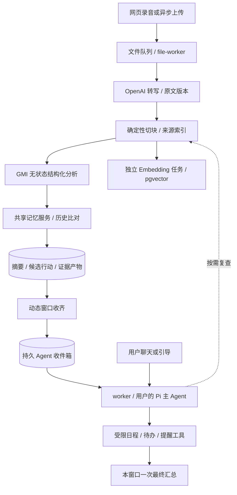

# 独立录音处理与动态窗口

文件分析采用独立后台任务和无状态模型调用。Compose 的 `file-worker` 与 `worker` 分别消费文件与索引队列、主 Agent 队列，各自管理执行锁、租约、并发及故障恢复。文件结果通过持久收件箱交给 Nota 的 Pi 主会话汇报。

## 动态窗口规则

窗口依据该用户正在处理的录音列表形成，由服务器管理，不按一次多选上传或一次硬件同步划定。

1. 第一条录音加入一个开放窗口；处理期间后来上传的文件继续加入。
2. 窗口累计达到 10 条立即封口。第 11 条进入下一窗口，前一窗口可以继续处理剩余文件。
3. 未满 10 条且仍有待处理文件时继续收集。所有成员均成功、失败或取消后，空闲 1.5 秒统一交接；这个短缓冲期间到来的录音仍会加入并清除收齐状态。
4. 满 10 条的窗口在全部成员进入终态后交接，不再等待空闲缓冲。单个失败文件不会无限阻塞汇报，第三方调用有超时及有限重试。
5. 接入、收齐检查和事件投递共用用户级短事务锁。完成和新上传竞争时，文件要么加入尚未交接的窗口，要么完整进入新窗口，不丢失、不超员。

示例：1 条正在处理时又来 5 条，6 条合并汇报；持续积压 15 条，形成 10＋5 两个窗口。`RECORDING_WINDOW_IDLE_MS` 可调整缓冲，容量固定为 10。

## 处理与交接

上传只保存音频、录制元数据、文件任务与窗口成员，不再给每条文件插入聊天请求。文件任务不取得 Pi 会话锁，也不打开 SDK 会话。完整原文只进入独立分析请求，默认不会注入主会话。

对话页不显示文件处理窗口或上传队列，后台进度在语音便签和执行记录中查看。前端只允许明确的 Agent 生命周期事件创建会话中的执行项，文件状态不能产生临时的“正在处理”消息。已读进度与消息分页见 [对话说明](CONVERSATION.md)。

结构化产物包含摘要、事实/人物候选、行动候选、原始时间表达、不确定项与真实文段引用。记忆服务查询已有录音和聊天事实，保留变化及可能的人物关联。批次成员全部终结后，在同一事务内创建一个派生 Agent operation 和唯一 `agent_inbox` 事件，再关联到窗口。队列只是唤醒通道，数据与交接状态以 PostgreSQL 为准，重启或重投不新增交办。

主 Agent 加载对应版本的摘要、候选行动、记忆变化及出处，不重新完成文件摘要。确认应执行的行动后使用真实工具，候选 ID 关联实际业务对象与回执。执行中仍有流式公开说明和折叠工具过程，完成后一次汇总。用户补充使用已有原生引导机制；尚在转写的文件和等待接入的系统事件不会自动吸收普通聊天。

关联日程的“提前一天”等纯相对提醒保存提前分钟数，主 Agent 使用 `event_id + before_minutes`，由后端根据真实日程计算。来源中的提前量与模型传入时刻冲突时拒绝写入并要求修正，不擅自选择上午或下午。原文另有明确提醒时刻、或用户随后明确更正时，保留该要求。候选再次读取返回同一业务对象的当前状态，原创建回执继续作为历史事实保留。

## 来源与检索

`source_chunks` 保存用户、来源类型/ID、原文版本、序号、字符范围、行范围、原文及内容哈希。字符位置采用 UTF-16 code units，与浏览器 `String.slice` 一致。文段 ID 由来源和版本确定；同一来源版本的重试保持稳定。没有真实 ASR 时间对齐时，时间范围保持空值，不生成假时间戳。

摘要事实与候选行动通过 `source_refs` 引用文段及原文范围，保存前校验实际原文、租户与版本；引用 URL 由服务端生成。`read_source(chunk_id,before,after)` 读取同版本相邻文段，`read_recording(recording_id,version,offset)` 分页读全文。网页出处能定位历史版本及附近原文，亦可打开该版本全文与原音。

`chunk_embeddings` 保存文段外键、Embedding 模型、维度和向量，默认 OpenAI `text-embedding-3-small` / 1536 维。PostgreSQL 镜像在原 PostgreSQL 17 Alpine 基础安装 pgvector 0.8.7，沿用原数据卷。向量检索先按用户、来源当前版本、日期及人物称呼过滤，与关键词结果通过 RRF 合并。首版使用精确余弦检索，不额外引入向量数据库或重排模型。

Embedding 异步执行，可从已完成分析的检查点重试；服务不可用时保留关键词检索。旧录音和用户消息后台补建文段/向量，不重新触发历史行动，不改写旧 SDK 会话。查询 Embedding 在业务事务及操作行锁之外调用，避免阻塞引导接入。

## 记忆与修订

当前统一写入流程为 `MemoryReview.prepare → 模型比较 → MemoryReview.apply`；原文与语义支持分别校验。录音复用摘要分析得到候选后批量比较，失败保存独立记忆重试任务，不使已完成的转写、摘要与行动一起失败。主 Agent 不重复提取录音记忆，按交接的 `memory_update.status` 汇报实际结果。业务执行字段不拆成长期事实，人物与事件背景通过真实业务 ID 关联。完整设计与三个入口见 [通用长期记忆](MEMORY.md)。

录音处理与聊天使用同一套记忆服务。已确认的身份和别名用于对齐人物，存在歧义时由用户确认。独立证据可合并到同一事实，明确更正时替换当前值并保留历史版本。完整生命周期见 [长期记忆](MEMORY.md)。

录制时间、录制时区和上传时间分别保存。浏览器采集时记录录制时间，离线补传沿用该时间；普通文件未提供可靠时间时标为未知，不使用上传时间冒充录制日期。主 Agent 按各条录制时间解释相对日期，明确的新日期或更正由用户指令决定。

原文修订生成新版本和新索引。交接前修订会将原窗口成员重新置为待处理，沿用原始额度；交接中的原文暂不能覆盖。已交付后的修订后台更新摘要/索引，不重新创建旧行动。修订继承原始处理范围和“不记忆”限制，不会重新激活已遗忘事实。默认检索使用当前版本，旧引用仍能复查；多来源事实只要仍有独立有效证据就继续可用。

## 额度与恢复

上传默认允许，不因免费处理额度耗尽而拒绝。额度不足时仍持久保存音频与录制元数据，便签显示“待处理”，文件任务等待额度，不预占、不转写、不分析，也暂不加入整理窗口。后台在北京时间每日 00:00 额度重置、失败释放名额或升级 Pro 后，按上传顺序为待处理录音原子预占可用额度，再加入动态窗口和文件队列；多个 worker 不会重复启动或超额处理。旧版本因额度不足而留在本机的录音在页面加载或联网后自动补传，收到服务端持久保存确认后清理本机副本。

窗口合并汇报，不合并每条录音的处理额度。一条录音保留原始预占，内部摘要、工具、派生事件与重试不另扣次。Agent 完成后结算成功成员，文件最终失败或后续 Agent 最终失败按原始业务日释放预占。Agent 重试通过 API 重新预占已释放的原请求，已完成业务回执及候选绑定复用，避免重复创建。

所有来源、窗口、候选、收件箱和业务对象均按用户鉴权。文件、Agent、索引任务分别保存执行租约；迟到写入必须通过租约和来源版本校验。批次部分失败仍生成一次包含成功及失败项的汇总。

## 验证入口

- `pnpm test:recordings`：动态续入、10＋5、收齐竞争、不阻塞聊天、单次交接、来源/版本隔离、记忆比对、pgvector、失败退款与重试、修订重处理、执行范围及索引检查点。
- `pnpm test:e2e`：PC/H5 动态续入、继续聊天、刷新恢复、一次汇总、工具过程、附近原文及全文。
- `pnpm test:recordings:live`：真实 6 条 OpenAI 转写、GMI 独立分析、原生 Pi Agent 汇总及 OpenAI 向量检索；使用隔离数据库并产生第三方用量。

参考：[pgvector](https://github.com/pgvector/pgvector)、[OpenAI Embedding](https://developers.openai.com/api/docs/guides/embeddings)。
